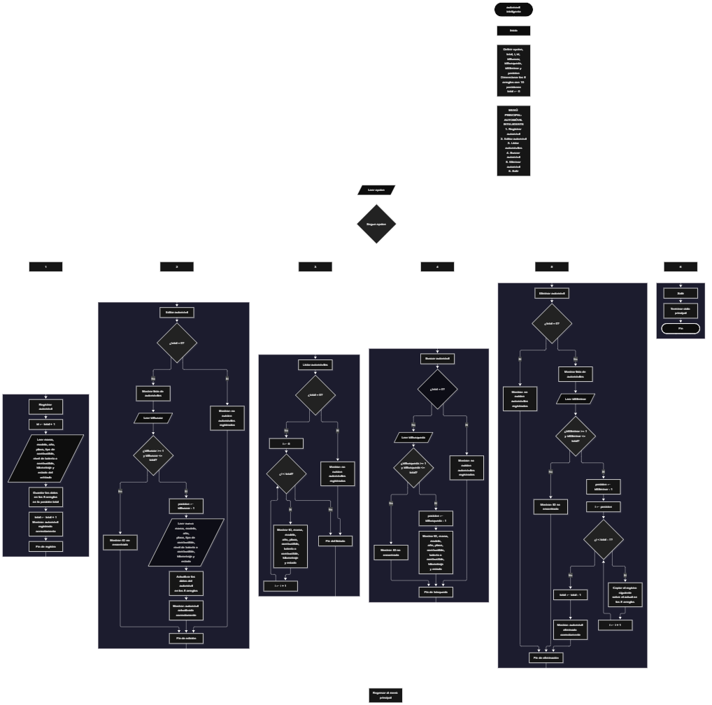

Este proyecto, llamado <b>automóvil inteligente</b>, fue desarrollado en <b>Java</b> como un ejercicio práctico para fortalecer la lógica de programación mediante la creación de un sistema de gestión de automóviles desde la consola. El programa cuenta con un menú principal de seis opciones que permite <b>registrar, editar, listar, buscar y eliminar</b> automóviles, además de finalizar la ejecución del sistema. Cada vehículo almacena información como la marca, el modelo, el año, la placa, el tipo de combustible, el nivel de batería o combustible, el kilometraje y el estado del vehículo, utilizando ocho arreglos con una capacidad máxima de <b>10 automóviles durante la ejecución</b>. Durante su desarrollo se aplicaron conceptos fundamentales de programación, como variables, arreglos, estructuras condicionales, ciclos repetitivos y estructuras de selección, además de procesos para buscar, modificar, eliminar y reorganizar registros. Este proyecto permite poner en práctica los conocimientos adquiridos en Java y sirve como base para desarrollar sistemas de gestión más avanzados utilizando otros lenguajes y tecnologías.

<h2 align="center">⚙️ Funcionamiento del menú principal</h2>

### ➕ Registrar automóvil

La opción <b>1) registrar automóvil</b> permite almacenar un nuevo vehículo en el sistema. Para comenzar, el programa calcula el identificador del automóvil mediante la variable <b>id</b>, utilizando la operación <b>total + 1</b>. Después, solicita la <b>marca, modelo, año, placa, tipo de combustible, nivel de batería o combustible, kilometraje y estado del vehículo</b>. Los datos se almacenan en la posición correspondiente de sus respectivos arreglos, utilizando la variable <b>total</b> como índice. Finalmente, muestra el mensaje <b>"Automovil registrado correctamente."</b> y aumenta la variable <b>total</b> en uno para contabilizar el nuevo registro.

### ✏️ Editar automóvil

La opción <b>2) editar automóvil</b> permite modificar la información de un vehículo registrado. Primero, el programa comprueba si existen automóviles almacenados mediante la condición <b>total == 0</b>. Si no hay registros, muestra el mensaje <b>"No existen automoviles registrados."</b>. En caso contrario, presenta una lista con el ID, marca, modelo, año, placa, combustible, nivel de batería o combustible, kilometraje y estado de cada automóvil. Después, solicita el ID del vehículo que se desea editar y comprueba que se encuentre dentro del rango permitido mediante la condición <b>idBuscar &gt;= 1 && idBuscar &lt;= total</b>. Si la selección es válida, calcula su posición mediante <b>idBuscar - 1</b> y solicita nuevamente todos los datos del automóvil, actualizando directamente los valores de los arreglos correspondientes. Finalmente, muestra el mensaje <b>"Automovil actualizado correctamente."</b>. Si el ID introducido no corresponde a un automóvil registrado, presenta el mensaje <b>"ID no encontrada."</b>.

### 📋 Listar automóviles

La opción <b>3) listar automóviles</b> permite visualizar todos los vehículos registrados actualmente en el sistema. Antes de mostrar la información, el programa comprueba si la variable <b>total</b> es igual a cero. Si no existen registros, presenta el mensaje <b>"No existen automoviles registrados."</b>. Si hay automóviles disponibles, utiliza un ciclo <b>for</b> para recorrer los arreglos desde la primera posición hasta el número total de registros. Durante el recorrido, muestra el ID, la marca, el modelo, el año, la placa, el tipo de combustible, el nivel de batería o combustible, el kilometraje y el estado de cada vehículo. Esta función facilita consultar todos los automóviles almacenados sin necesidad de buscarlos individualmente.

### 🔎 Buscar automóvil

La opción <b>4) buscar automóvil</b> permite localizar un vehículo mediante su ID. Primero, el programa comprueba si existen automóviles registrados. Si el sistema está vacío, muestra el mensaje <b>"No existen automoviles registrados."</b>. En caso contrario, solicita el ID del automóvil que se desea buscar y verifica que se encuentre dentro del rango permitido mediante la condición <b>idBusqueda &gt;= 1 && idBusqueda &lt;= total</b>. Si el ID es válido, calcula la posición correspondiente utilizando <b>idBusqueda - 1</b> y muestra todos los datos del vehículo encontrado: <b>marca, modelo, año, placa, tipo de combustible, nivel de batería o combustible, kilometraje y estado</b>. Si el ID introducido no corresponde a ningún registro existente, presenta el mensaje <b>"ID no encontrada."</b>.

### 🗑️ Eliminar automóvil

La opción <b>5) eliminar automóvil</b> permite eliminar un vehículo registrado mediante su ID. Antes de comenzar, el programa comprueba si existen automóviles almacenados. Si no hay registros, muestra el mensaje <b>"No existen automoviles registrados."</b>. Si existen vehículos disponibles, presenta una lista con sus respectivos datos y solicita el ID del automóvil que se desea eliminar. Después, verifica que el ID esté dentro del rango válido. Si el vehículo existe, calcula su posición mediante <b>idEliminar - 1</b> y comienza el proceso de eliminación. Para mantener los registros activos organizados, utiliza un ciclo <b>for</b> controlado por la variable <b>i</b>, que desplaza una posición hacia atrás los datos de los automóviles posteriores en los ocho arreglos. Posteriormente, disminuye la variable <b>total</b> en uno y muestra el mensaje <b>"Automovil eliminado correctamente."</b>. Si el ID seleccionado no corresponde a un automóvil registrado, informa mediante el mensaje <b>"ID no encontrada."</b>.

### 🚪 Salir del menú principal

La opción <b>6) salir</b> está destinada a finalizar la ejecución del programa y muestra el mensaje <b>"Gracias por utilizar Automovil Inteligente."</b>. El menú principal se encuentra dentro de una estructura repetitiva <b>do ... while</b>, que mantiene el programa en funcionamiento mientras se realizan las operaciones disponibles. La condición <b>opcion != 6</b> permite repetir el menú hasta que el usuario seleccione la opción número <b>6</b>. Cuando esto sucede, el ciclo termina y el programa cierra el objeto <b>Scanner</b> mediante la instrucción <b>entrada.close()</b>.

<h2 align="center">🧠 Temas aplicados en el proyecto</h2>

### 📦 Variables

En este proyecto se utilizan variables para almacenar la opción seleccionada en el menú, controlar la cantidad de automóviles registrados, recorrer los arreglos y determinar la posición de los vehículos que se desean editar, buscar o eliminar. También se utilizan variables auxiliares para almacenar los identificadores introducidos por el usuario. Cada variable cumple una función específica dentro de las operaciones de gestión de automóviles.

🔢 **Opcion:** Almacena la opción seleccionada por el usuario en el menú principal.

📊 **Total:** Almacena la cantidad actual de automóviles registrados.

🔄 **I:** Funciona como contador en los ciclos `for` y permite recorrer los arreglos durante el listado y la eliminación de registros.

🆔 **Id:** Calcula el identificador del automóvil que se va a registrar mediante la operación `total + 1`.

✏️ **IdBuscar:** Almacena el ID introducido por el usuario para seleccionar el automóvil que desea editar.

🔎 **IdBusqueda:** Almacena el ID utilizado para buscar un automóvil registrado.

🗑️ **IdEliminar:** Almacena el ID del automóvil que se desea eliminar.

📍 **Posicion:** Almacena el índice correspondiente al automóvil seleccionado, calculado restando uno al ID introducido.

### 🗃️ Arreglos

En este proyecto se utilizan ocho arreglos relacionados con la información de cada automóvil. Cada arreglo tiene una capacidad de <b>10 posiciones</b> y utiliza el mismo índice para representar los datos correspondientes a un mismo vehículo. Por ejemplo, la información de un automóvil almacenado en la posición <b>0</b> se encuentra distribuida entre <b>marcas[0], modelos[0], anios[0], placas[0], combustibles[0], baterias[0], kilometrajes[0] y estados[0]</b>. Esta organización permite recorrer, buscar, modificar, mostrar y eliminar los vehículos de manera ordenada.

🚘 **Marcas[10]:** Almacena las marcas de los automóviles registrados.

🚗 **Modelos[10]:** Almacena los modelos de los automóviles.

📅 **Anios[10]:** Almacena los años de fabricación de los vehículos.

🔖 **Placas[10]:** Almacena las placas correspondientes a cada automóvil.

⛽ **Combustibles[10]:** Almacena el tipo de combustible utilizado por cada vehículo.

🔋 **Baterias[10]:** Almacena el nivel de batería o combustible en porcentaje.

🛣️ **Kilometrajes[10]:** Almacena el kilometraje de cada automóvil.

⚙️ **Estados[10]:** Almacena el estado actual de cada vehículo.

### 🔀 Estructuras condicionales

En este proyecto se utilizan las estructuras <b>if</b> y <b>else</b> para comprobar si existen automóviles registrados antes de realizar determinadas operaciones y verificar que el ID introducido por el usuario corresponda a un vehículo existente. Estas condiciones se aplican principalmente en las opciones de <b>editar, buscar y eliminar</b>, permitiendo ejecutar las instrucciones correspondientes cuando la selección es válida o mostrar un mensaje cuando no existen registros o el ID no se encuentra dentro del rango permitido.

### 🔄 Estructuras repetitivas

En este proyecto se utilizan los ciclos <b>do ... while</b> y <b>for</b>. El ciclo <b>do ... while</b> mantiene activo el menú principal y permite ejecutar diferentes operaciones hasta que el usuario selecciona la opción de salida. Por otro lado, los ciclos <b>for</b> permiten recorrer los arreglos para mostrar los automóviles registrados y desplazar los datos de los vehículos posteriores durante el proceso de eliminación. Estas estructuras facilitan la administración de los registros sin necesidad de repetir manualmente las instrucciones.

### 🎯 Estructura switch

El programa utiliza la estructura <b>switch</b> para evaluar el valor almacenado en la variable <b>opcion</b> y ejecutar el bloque de instrucciones correspondiente. Cada caso representa una operación específica del sistema: <b>registrar, editar, listar, buscar, eliminar o salir</b>. También se utiliza el bloque <b>default</b> para mostrar el mensaje <b>"Opcion no valida."</b> cuando el usuario introduce un número que no coincide con ninguna de las opciones definidas en el menú.

### 🔢 Dimensionamiento de arreglos

En este proyecto se utiliza la creación de arreglos mediante la instrucción <b>new</b> para establecer la capacidad de almacenamiento de la información de los automóviles. Se definieron <b>10 posiciones</b> para cada uno de los ocho arreglos, lo que permite administrar hasta 10 vehículos durante la ejecución del programa. La cantidad de posiciones ocupadas se controla mediante la variable <b>total</b>, por lo que las operaciones recorren únicamente los registros comprendidos entre la primera posición y el total actual de automóviles. Sin embargo, el programa todavía no incluye una comprobación que impida superar la capacidad establecida.

### 🔄 Reorganización de registros

Cuando se selecciona un automóvil para eliminarlo, el programa utiliza un ciclo <b>for</b> que comienza en la posición seleccionada y continúa hasta <b>total - 1</b>. En cada repetición, los datos de la posición siguiente se copian sobre la posición actual en los ocho arreglos: <b>marcas, modelos, anios, placas, combustibles, baterias, kilometrajes y estados</b>. Después, la variable <b>total</b> disminuye en uno para actualizar la cantidad de vehículos registrados. De esta manera, los automóviles posteriores ocupan las posiciones disponibles y se mantienen organizados dentro de los arreglos.

<h2 align="center">¿Cómo se implementaron las operaciones crud en el proyecto?</h2>

Las operaciones <b>CRUD</b> se implementaron mediante las opciones del menú principal, permitiendo administrar la información de los automóviles registrados. La operación <b>crear</b> corresponde a <b>registrar automóvil</b>, donde se introducen los datos de un nuevo vehículo; <b>leer</b> se realiza mediante las opciones <b>buscar automóvil y listar automóviles</b>; <b>actualizar</b> corresponde a <b>editar automóvil</b>, donde se modifican los datos de un vehículo existente; y <b>eliminar</b> se realiza mediante la opción <b>eliminar automóvil</b>. Estas operaciones utilizan variables, arreglos, condicionales y ciclos para gestionar la información almacenada temporalmente durante la ejecución del programa.

<h2 align="center">Diagrama de flujo del proyecto</h2>

<h2 align="center">🛡️ Validaciones del programa</h2>

### 📭 No existen automóviles registrados

Esta validación se utiliza en las opciones de <b>editar, listar, buscar y eliminar</b>. El programa comprueba si la variable <b>total</b> es igual a <b>0</b> y, si no existen automóviles registrados, muestra el mensaje <b>"No existen automoviles registrados."</b>. Esta comprobación evita continuar con las operaciones que necesitan información almacenada cuando el sistema está vacío.

### 🔢 Selección de automóviles

Esta validación se utiliza durante las operaciones de <b>editar, buscar y eliminar</b>. El programa comprueba que el ID introducido por el usuario sea mayor o igual a <b>1</b> y menor o igual al valor de <b>total</b>. Si la selección se encuentra dentro del rango permitido, calcula la posición correspondiente restando uno al identificador. En caso contrario, muestra el mensaje <b>"ID no encontrada."</b>. Esta comprobación evita modificar, buscar o eliminar posiciones que no corresponden a automóviles registrados.

### ⚠️ Capacidad de almacenamiento

Los ocho arreglos tienen una capacidad máxima de <b>10 automóviles</b>. Sin embargo, el programa todavía no cuenta con una condición que compruebe si existe espacio disponible antes de registrar un nuevo vehículo. Por este motivo, si se intenta registrar un automóvil cuando los 10 espacios ya están ocupados, se puede producir una excepción de tipo <b>ArrayIndexOutOfBoundsException</b> al intentar acceder a una posición fuera de los límites del arreglo.

### ⚠️ Validación de datos numéricos

El programa utiliza los métodos <b>nextInt()</b> y <b>nextDouble()</b> de la clase <b>Scanner</b> para recibir los valores correspondientes al año, el nivel de batería o combustible y el kilometraje. Sin embargo, todavía no cuenta con comprobaciones que validen los rangos permitidos para estos datos ni que controlen la introducción de valores de texto en campos numéricos. Por esta razón, es importante introducir los tipos de datos esperados para evitar errores durante la ejecución.

### ❌ Opción inválida

La estructura <b>switch</b> incluye el bloque <b>default</b>, que muestra el mensaje <b>"Opcion no valida."</b> cuando el usuario introduce un número que no corresponde a ninguna de las seis opciones definidas en el menú. Esta condición permite informar al usuario cuando selecciona una opción que no está disponible.

<h2 align="center">🎯 Objetivo del proyecto</h2>

El objetivo principal de este proyecto es fortalecer la <b>lógica de programación</b> mediante el desarrollo de un sistema de gestión de automóviles en <b>Java</b>. A través de su construcción se busca aplicar los conocimientos adquiridos sobre variables, arreglos, estructuras condicionales, ciclos repetitivos y estructuras de selección, integrándolos para resolver un problema de manera organizada. Además, el proyecto permite comprender cómo registrar, consultar, modificar y eliminar información en una aplicación de consola, estableciendo una base para desarrollar sistemas de gestión más completos con otros lenguajes y tecnologías.

